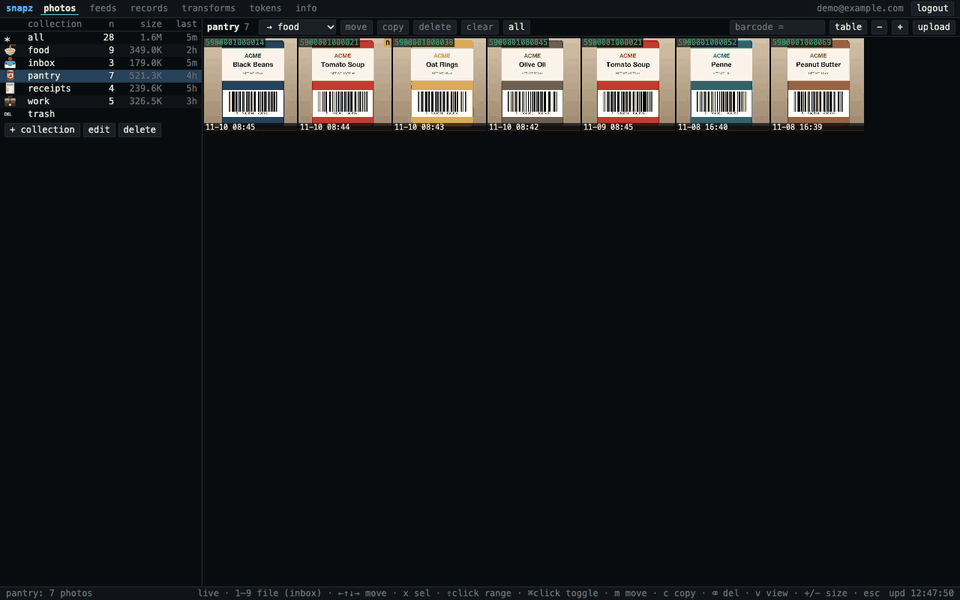
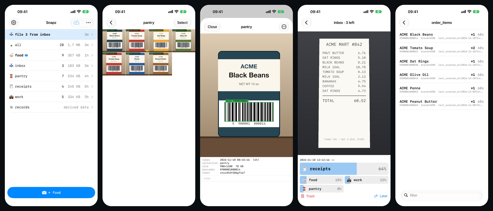
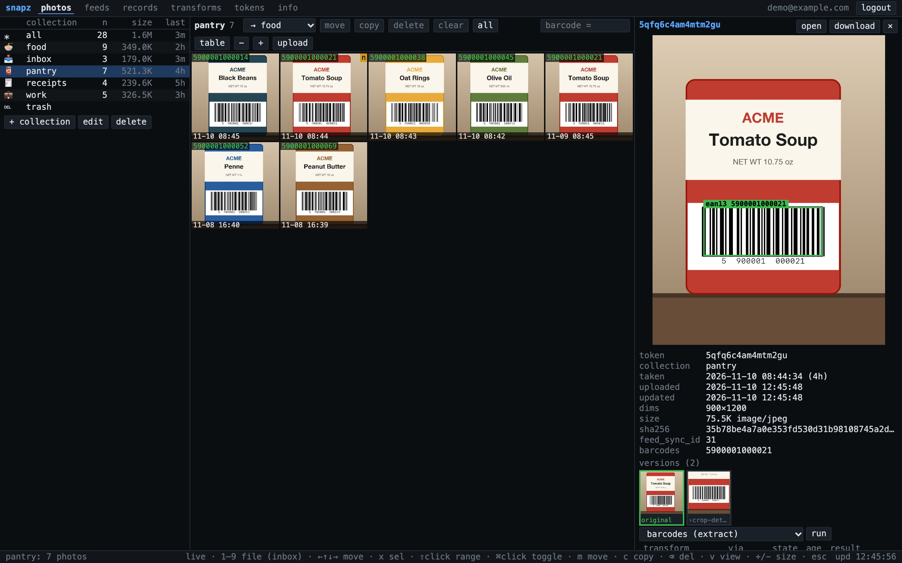
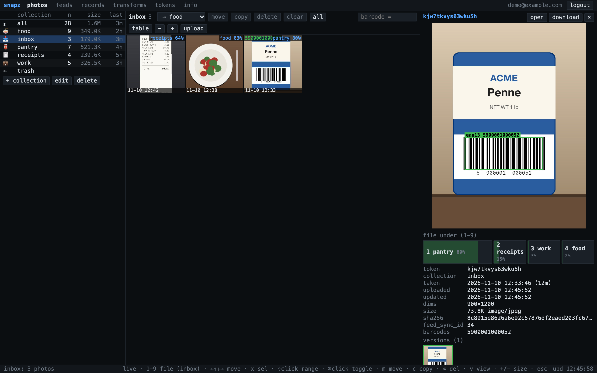
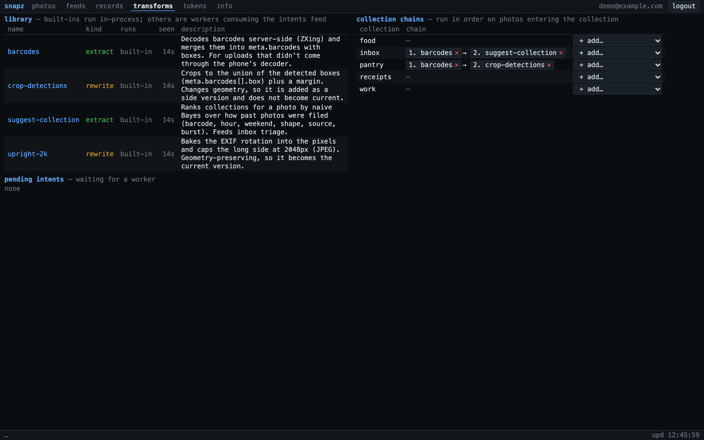

# snapz





<table>
<tr>
<td width="50%"><br><sub>Collection grid, detection box, version tree, transform history</sub></td>
<td width="50%"><br><sub>Inbox: file with one key, ranked by P(collection)</sub></td>
</tr>
<tr>
<td colspan="2"><br><sub>Transform library and per-collection chains</sub></td>
</tr>
</table>

<sub>All screenshots use generated, obviously fake data (ACME everything). The camera HUD isn't pictured: the simulator has no camera.</sub>

Photos that never touch the iPhone library: shoot into named collections (pantry, food, work,
illness…), browse/move/copy/delete from the web, and consume everything as a feedz-style change
feed so small scripts can turn, say, pantry UPC scans into order items.

    ios/      SwiftUI app: camera → on-device barcode detect → durable offline upload queue
    server/   Kotlin + misk: JSON API, blobs on disk, MySQL, OIDC + bearer tokens, feeds, web UI
    scripts/  snapz.py (stdlib client, feed @transform lib, image-transform workers),
              pantry_orders.py, transform_examples.py
    deploy/   Dockerfile / compose / config templates

## run locally

    mysql -uroot -e 'create database if not exists snapz_dev; create database if not exists snapz_test'
    cd server && . bin/activate-hermit
    ./gradlew test                                   # real HTTP against snapz_test
    cp snapz-local.yaml.example snapz-local.yaml     # gitignored; set a dev token in it
    SNAPZ_CONFIG=$PWD/snapz-local.yaml ./gradlew run # http://localhost:8788

`snapz-local.yaml` defines a `bootstrap_tokens` entry; paste that token on the login page. With `snapz.oidc` configured the page offers SSO instead.

## model

| thing | notes |
|---|---|
| collection | `slug` is the id. Soft-deleted; slug is freed for reuse. |
| photo | row → blob by sha256 (`<blob_dir>/orig/ab/<sha>`, thumbs alongside). **copy** = new row, same blob; **move** = change collection; **delete** = trash (restorable), `POST /api/admin/purge` hard-deletes + GCs unreferenced blobs. `meta` is free-form JSON; `meta.barcodes[].value` is denormalized to `barcodes`. |
| version | one stored image of a photo. The upload is the root; each image-rewriting transform adds a child of the version it read. The photo row mirrors the *current* version; `PUT /api/photos/{t}/current` moves it (nothing is deleted). |
| transform | a named operation: `extract` (returns data, optionally a patch for `photo.meta`) or `rewrite` (returns a new image). Built-ins run in-process; anything else is an external worker. |
| intent / result | append-only events: "run T on photo P at version V" and what T answered. An intent's state is its latest result (`ok`/`skipped`/`halt`/`error`) or `pending`. |
| record | generic JSON doc at `(ns, k)` — where transforms write derived state. |
| token | `session` (web cookie), `device` (iOS), `script` (you mint these). SHA-256 hashes only. |

## auth

- **Web**: `/auth/login` → OIDC code flow (+PKCE) against the configured issuer (Pocket ID; any
  OIDC provider incl. Google works) → `HttpOnly; SameSite=Lax` session cookie. Access is limited to
  `allowed_emails` / `allowed_groups`.
- **iOS**: same flow inside `ASWebAuthenticationSession`, ending at `snapz://auth?code=…`; the app
  trades that one-time code + its own PKCE verifier for a long-lived, individually revocable
  device token (Keychain).
- **Scripts**: `Authorization: Bearer snapz_…`, minted in the web UI (tokens tab) or
  `POST /api/tokens {"name": …}`.

## API (JSON, snake_case, ISO-8601 UTC timestamps)

    GET    /api/collections                         POST {name, slug?, description?, icon?}
    GET|PATCH|DELETE /api/collections/{slug}        DELETE ?force=true trashes its photos too
    GET    /api/photos?collection=&barcode=&deleted=&limit=&before=<next_before>
    POST   /api/photos?collection=&taken_at=&note=&meta=<json>&client_id=<idempotency key>
           body = raw image bytes:  curl -H "Authorization: Bearer $T" --data-binary @x.jpg "$U/api/photos?collection=pantry"
    GET|PATCH|DELETE /api/photos/{token}            PATCH {note?, meta?, taken_at?, collection?(=move)}
    POST   /api/photos/{token}/copy {collection}    POST /api/photos/{token}/restore
    POST   /api/photos/batch {op: move|copy|delete|restore, tokens: [...], collection?}   (all-or-nothing)
    GET    /blobs/{token}[?size=thumb][&version=<v>] URLs from the API carry ?v=<sha> and are immutable; a bare one revalidates
    GET    /api/photos/{token}/history              versions (tree) + intents with results
    POST   /api/photos/{token}/intents {transform, params?}      PUT /api/photos/{token}/current {version}
    GET    /api/transforms                          PUT /api/transforms/{name} {kind, description?}
    GET|PUT /api/collections/{slug}/transforms      the collection's chain: {transforms: [{transform, params?}]}
    GET    /api/intents?transform=                  pending work      POST /api/intents/{i}/results {status?, data?, meta_patch?, error?, worker?}
    POST   /api/intents/{i}/output?worker=&data=&current=   body = the rewritten image
    GET    /api/inbox                               inbox photos + collections ranked by probability
    GET    /api/info                                every product enum, with meanings
    GET    /api/records                             namespaces
    GET    /api/records/{ns}?prefix=                GET|PUT|DELETE /api/records/{ns}/{k}   (PUT body = the JSON value)
    GET|POST /api/tokens                            DELETE /api/tokens/{id}

## feeds

Same model as feedz: the tables are the feed. Every mutation NULLs the row's `feed_sync_id`; a
single publisher (every 500 ms) assigns fresh monotonic ids per feed, so consumers paging
`feed_sync_id > cursor` see each row's latest state at least once. Deletes arrive as entries with
`deleted_at` set.

    GET /_feeds/fetch/{photos|collections|records|intents|results}?after=N&limit=&collection=&ns=&transform=&shard=&shard_count=
        → {"feed": "photos", "entries": [...], "cursor": N'}        # poll again with after=N'
    GET|PUT|DELETE /_feeds/cursors/{consumer}?feed=                  # server-side cursor storage
    GET /_feeds/status                                               # sequences, pending, consumer lag
    PUT /_feeds/publishing/{feed} {enabled}                          # per-feed publish switch
    POST /_feeds/publish?feed=&force=true                            # publish now / step a paused feed

### transforms

`scripts/snapz.py` is one stdlib-only file: a client, a consumer loop with server-stored cursors,
and a `@transform` decorator (feed → function → records namespace). Records are a feed too, so
transforms chain.

```python
from snapz import run, transform

@transform("photos", consumer="pantry-orders", sink="order_items")
def order_items(photo, sz):
    ...
    yield upc, {"upc": upc, "qty": n, ...}     # (key, None) deletes
run()   # --once | --follow | --rewind | --dry-run
```

`scripts/pantry_orders.py` is the worked example: barcoded photos in `pantry` → `order_items/<upc>`
with name/brand/size from Open Food Facts (cached in `products/`). It is a pure function of the
live scans, so replays are no-ops and deleting/moving a scan retracts it. Known gap: editing a
photo's `meta` to *remove* a barcode doesn't retract the old UPC.

    export SNAPZ_URL=http://localhost:8788 SNAPZ_TOKEN=…     # or ~/.config/snapz/env (chmod 600)
    scripts/pantry_orders.py --follow
    scripts/snapz.py status | ls [coll] | tail photos -f collection=pantry | upload pantry x.jpg --barcode 0016000275287

## image transforms

A collection has an ordered **chain** of transforms. A photo entering the collection (upload, move,
copy) gets an intent for the first link; each `ok`/`skipped` result queues the next link against
the photo as the previous one left it. `halt` or `error` ends the chain — an interceptor chain
whose `proceed()` is an event. Because every step is an intent plus a result, a photo's whole
processing history is two append-only streams, and both are feeds.

Built-in (in-process, see the web UI's transforms tab):

| name | kind | does |
|---|---|---|
| `suggest-collection` | extract | ranks collections for the photo (see inbox) |
| `barcodes` | extract | ZXing decode → `meta.barcodes` with boxes. Weaker than the phone's decoder; for web/CLI uploads |
| `upright-2k` | rewrite | bakes EXIF rotation, caps the long side at 2048px; becomes current |
| `crop-detections` | rewrite | crops to the detected boxes; a side version, not current (it changes geometry) |

External workers consume `/_feeds/fetch/intents?transform=<name>` and post a result. With
`scripts/snapz.py` that is a decorated function:

```python
from snapz import image_transform, run, Skip, Halt

@image_transform("dominant-color", kind="extract")
def dominant(intent, image, sz):      # image = bytes of the version the intent reads
    return {"hex": "#aabbcc"}, {"dominant_color": "#aabbcc"}   # data, meta_patch

@image_transform("gray", kind="rewrite")
def gray(intent, image, sz):
    return new_image_bytes
run()
```

`scripts/transform_examples.py` has both, implemented with macOS `sips`. Rewrites that change
geometry should pass `current=False`: detection boxes are fractions of the image they were found in.

## inbox

Shoot into `inbox` (created at startup) to decide later. `GET /api/inbox` ranks every other
collection for each waiting photo by naive Bayes over how photos were filed so far — features:
has a barcode, 3-hour bucket, weekend, portrait/landscape, `meta.source`, and the collection of the
nearest filed photo within 10 minutes (bursts go together). Filing is just a move, and each one is
new evidence, so ranks are recomputed on every read. The web UI shows them in the photo detail
(keys 1–9 file the focused photo); the iOS app has a one-photo-at-a-time triage screen.

## iOS app

Needs full Xcode and a signing team. Your team id, bundle id prefix and default server URL go in
`ios/Local.xcconfig` (gitignored):

    cd ios && cp Local.xcconfig.example Local.xcconfig   # edit it
    brew install xcodegen && xcodegen && open Snapz.xcodeproj

- Capture is in-app (AVFoundation) and writes only to the app's own storage — never PhotoKit.
- Each shot is saved to an on-disk queue first, then uploaded oldest-first with its id as
  `client_id`; retries can't duplicate, and nothing is deleted locally until the server acks.
  Uploads run while the app is foregrounded plus the short grace iOS grants after backgrounding
  (not a background URLSession yet).
- The capture screen decodes barcodes live from the viewfinder (boxes + status lights), uses the
  multi-lens camera so close-ups focus, and in AUTO saves by itself when a code it hasn't captured
  this session locks. The saved still is scanned again with Vision; both sets go into
  `meta.barcodes` with boxes. UPC-A is reported as 13-digit EAN-13.
- Inbox triage, a records browser, and detection boxes on the photo detail.
- Verified: builds for simulator and device; `SnapzUITests` drives collections → grid → detail →
  select → camera sheet in the simulator against a dev server:

      TEST_RUNNER_SNAPZ_URL=http://localhost:8788 TEST_RUNNER_SNAPZ_TOKEN=<token> \
        xcodebuild test -project Snapz.xcodeproj -scheme Snapz -destination 'platform=iOS Simulator,name=<sim>'

  The simulator has no camera, so capture, barcode detection and the SSO sheet are only proven on
  a real device.
- Debug builds accept `SNAPZ_DEBUG_TOKEN` (env) and `-serverURL <url>` (launch arg) to skip sign-in.
- A phone reaching a dev server over plain http must use the Mac's IP (ATS only exempts IPs and
  unqualified/.local names).

## deploy

`deploy/` has a Dockerfile, a compose file and config templates. Everything host-specific stays out
of git:

    cp deploy/.env.example deploy/.env                  # blob dir, bind address, subnet
    cp deploy/snapz.yaml.example deploy/snapz.yaml      # public_url, DB, OIDC client + allowlist (chmod 600)

You need an OIDC client whose callback is `<public_url>/auth/callback`, a TLS reverse proxy in
front of port 8788, a `snapz` MySQL database, and a blob directory that gets backed up. If the
identity provider is only reachable on your LAN/VPN, signing in from the phone needs that network;
capture itself works anywhere (offline queue).
