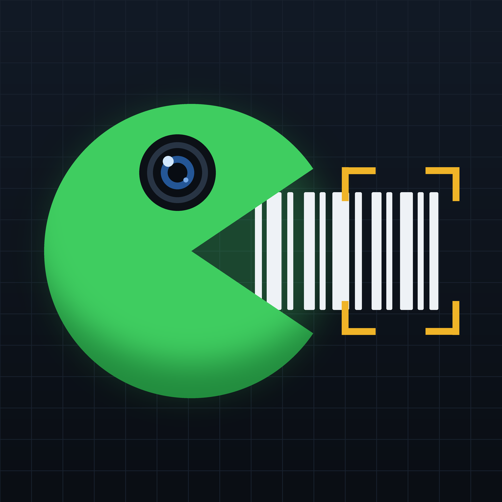
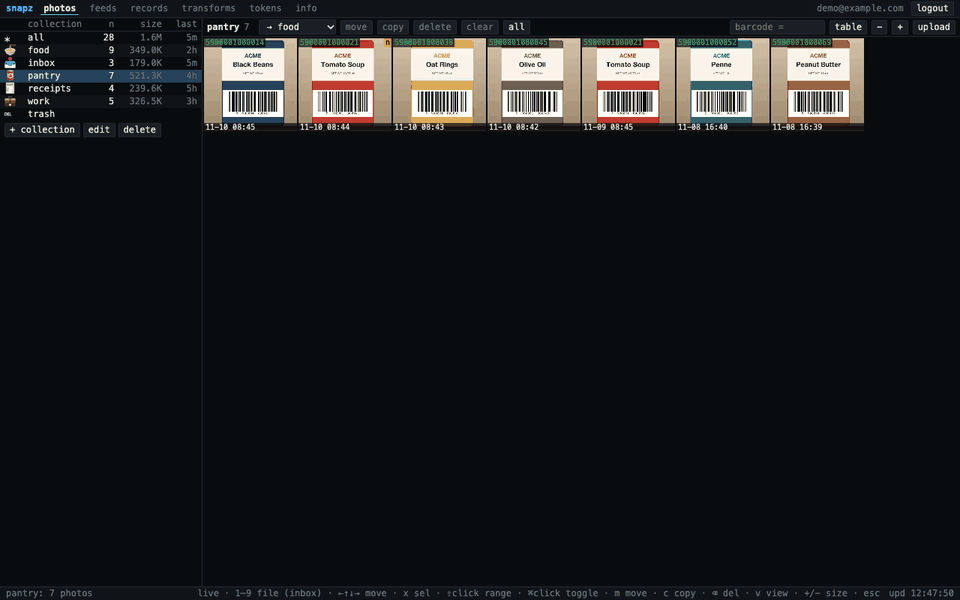
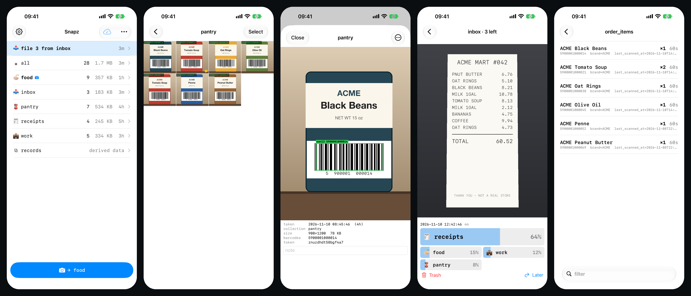
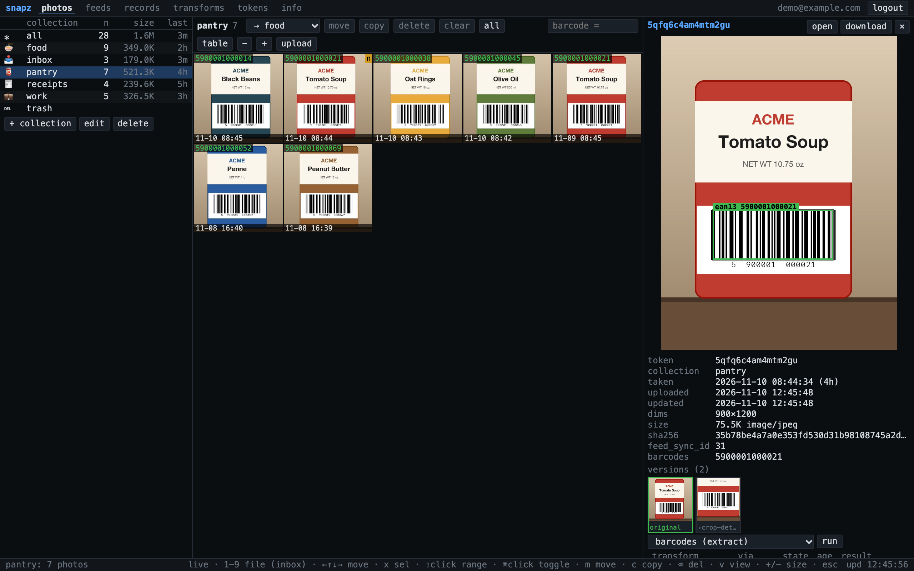
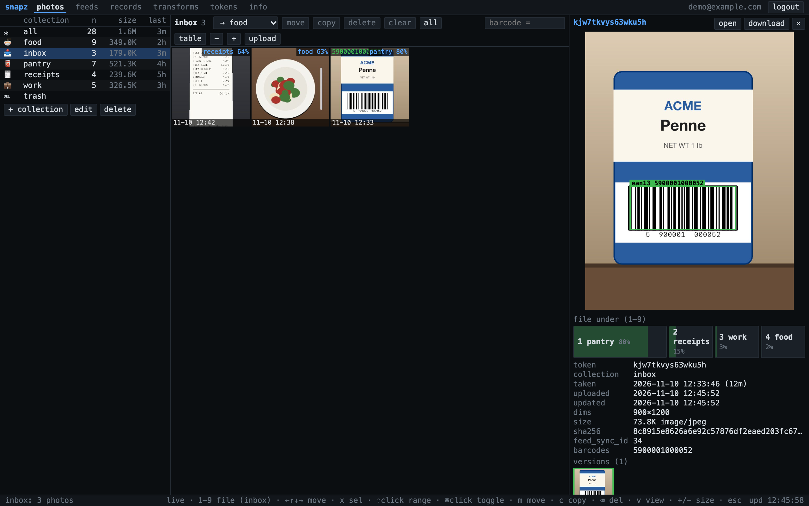
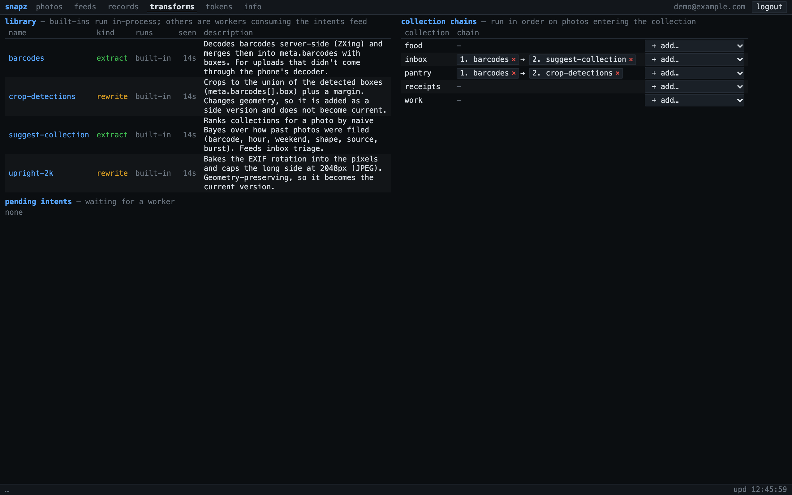

#  snapz





<table>
<tr>
<td width="50%"><br><sub>Collection grid, detection box, version tree, transform history</sub></td>
<td width="50%"><br><sub>Inbox: file with one key, ranked by P(collection)</sub></td>
</tr>
<tr>
<td colspan="2"><br><sub>Transform library and per-collection chains</sub></td>
</tr>
</table>

<sub>All screenshots use generated, obviously fake data (ACME everything). The camera HUD isn't pictured: the simulator has no camera.</sub>

Photos that never touch the iPhone library: shoot into named collections (pantry, food, work,
illness…), browse/move/copy/delete from the web, and consume everything as a feedz-style change
feed so small scripts can turn, say, pantry UPC scans into order items.

    ios/      SwiftUI app: camera → on-device barcode detect → durable offline upload queue
    server/   Kotlin + misk: JSON API, blobs on disk, MySQL, OIDC + bearer tokens, feeds, web UI
    scripts/  snapz.py (stdlib client, feed @transform lib, image-transform workers),
              pantry_orders.py, transform_examples.py
    deploy/   Dockerfile / compose / config templates

## run locally

    mysql -uroot -e 'create database if not exists snapz_dev; create database if not exists snapz_test'
    cd server && . bin/activate-hermit
    ./gradlew test                                   # real HTTP against snapz_test
    cp snapz-local.yaml.example snapz-local.yaml     # gitignored; set a dev token in it
    SNAPZ_CONFIG=$PWD/snapz-local.yaml ./gradlew run # http://localhost:8788

`snapz-local.yaml` defines a `bootstrap_tokens` entry; paste that token on the login page. With `snapz.oidc` configured the page offers SSO instead.

## model

| thing | notes |
|---|---|
| vault | a namespace over everything below: its own collections, records and inbox (like a password manager's vaults). `slug` is the id; the same collection slug in two vaults is two collections. Blobs stay deduplicated across vaults. |
| collection | `slug` is the id. Soft-deleted; slug is freed for reuse. |
| photo | row → blob by sha256 (`<blob_dir>/orig/ab/<sha>`, thumbs alongside). **copy** = new row, same blob; **move** = change collection; **delete** = trash (restorable), `POST /api/admin/purge` hard-deletes + GCs unreferenced blobs. `meta` is free-form JSON; `meta.barcodes[].value` is denormalized to `barcodes`. |
| version | one stored image of a photo. The upload is the root; each image-rewriting transform adds a child of the version it read. The photo row mirrors the *current* version; `PUT /api/photos/{t}/current` moves it (nothing is deleted). |
| transform | a named operation: `extract` (returns data, optionally a patch for `photo.meta`) or `rewrite` (returns a new image). Built-ins run in-process; anything else is an external worker. |
| intent / result | append-only events: "run T on photo P at version V" and what T answered. An intent's state is its latest result (`ok`/`skipped`/`halt`/`error`) or `pending`. |
| record | generic JSON doc at `(ns, k)` — where transforms write derived state. |
| token | `session` (web cookie), `device` (iOS), `script` (you mint these). SHA-256 hashes only. A script token can be pinned to one vault, read-only, and/or expiring. |

### vaults

A request picks its vault with the `X-Snapz-Vault: <slug>` header or `?vault=<slug>`; with neither
it lands in the default vault (`default_vault`, `personal`), so pre-vault clients keep working.

- Things addressed **by name** (a collection slug, a record `ns/k`, the inbox, a listing) resolve
  in the request's vault.
- Things addressed **by token** (photos, blobs, intents) are found wherever they live. Moving or
  copying a photo "to collection C" puts it in C *of the request's vault*, which is the whole
  cross-vault API.
- Feeds carry every vault unless one is named; each entry says which (`vault`).
- A token minted with `{"vault": "work"}` sees only that vault (404 for anything else, 403 for
  naming another) and none of the admin routes: vault and token management, purge, feed publish
  switches. `read_only: true` limits a token to GETs plus saving its own feed cursor;
  `ttl_days` expires it.

    GET|POST /api/vaults            PATCH|DELETE /api/vaults/{slug}[?force=true]

Deleting a vault is a soft delete that trashes what it holds; the default vault can't be deleted.
A vault separates what a caller can see. It is not encryption: one database, one blob directory.

### actions

A barcode says which item, not what happened to it. Each collection can have an **action set**:
the verbs a photo filed there can carry (`meta.action`, plus `meta.qty` for actions that take one).

    PUT   /api/collections/{slug}/actions  {"actions": [{"name": "consume", "label": "USE −", "qty": true}, …]}
    PATCH /api/photos/{token}              {"collection": "pantry", "action": "consume", "qty": 2}
    POST  /api/photos/batch                {"op": "move", "tokens": […], "collection": "pantry", "action": "purchase", "qty": 1}

The server only stores the names and checks membership; the consumer of the feed gives them
meaning and is the natural owner of the list. The verb is part of filing: inbox triage asks for
it after the collection (ranked like the collections are), a batch move labels a whole selection,
and leaving the collection clears it. Shooting straight into a collection with actions, the
capture HUD offers that collection's set as a sticky mode (unloading groceries = 30 × `purchase`).

`scripts/pantry_orders.py` is the example owner. It registers the pantry's set on startup:

| action | meaning there |
|---|---|
| *(none)* | "need this" |
| `consume` | used qty: stock −= qty |
| `out` | that was the last one: stock = 0 (and "need this") |
| `purchase` | bought qty: stock += qty |
| `count` | counted the shelf: stock = qty |

and folds them, in `taken_at` order, into a `stock` records namespace.

## auth

- **Web**: `/auth/login` → OIDC code flow (+PKCE) against the configured issuer (Pocket ID; any
  OIDC provider incl. Google works) → `HttpOnly; SameSite=Lax` session cookie. Access is limited to
  `allowed_emails` / `allowed_groups`.
- **iOS**: same flow inside `ASWebAuthenticationSession`, ending at `snapz://auth?code=…`; the app
  trades that one-time code + its own PKCE verifier for a long-lived, individually revocable
  device token (Keychain).
- **Scripts**: `Authorization: Bearer snapz_…`, minted in the web UI (tokens tab) or
  `POST /api/tokens {"name": …}`.
- **Issuer JWTs**: with `snapz.oidc` set, a JWT signed by the issuer whose `aud` is `client_id` (or
  one of `oidc.bearer_audiences`) also works as `Authorization: Bearer`, for people on the same
  allowlist. Verified locally against the issuer's JWKS by
  [misk-oidc](../misk-oidc) (a sibling checkout; not published yet). Not revocable before `exp`.

## API (JSON, snake_case, ISO-8601 UTC timestamps)

    GET    /api/collections                         POST {name, slug?, description?, icon?}
    GET|PATCH|DELETE /api/collections/{slug}        DELETE ?force=true trashes its photos too
    GET    /api/photos?collection=&barcode=&deleted=&limit=&before=<next_before>
    POST   /api/photos?collection=&taken_at=&note=&meta=<json>&client_id=<idempotency key>
           body = raw image bytes:  curl -H "Authorization: Bearer $T" --data-binary @x.jpg "$U/api/photos?collection=pantry"
    GET|PATCH|DELETE /api/photos/{token}            PATCH {note?, meta?, taken_at?, collection?(=move)}
    POST   /api/photos/{token}/copy {collection}    POST /api/photos/{token}/restore
    POST   /api/photos/batch {op: move|copy|delete|restore, tokens: [...], collection?}   (all-or-nothing)
    GET    /blobs/{token}[?size=thumb][&version=<v>] URLs from the API carry ?v=<sha> and are immutable; a bare one revalidates
    GET    /api/photos/{token}/history              versions (tree) + intents with results
    POST   /api/photos/{token}/intents {transform, params?}      PUT /api/photos/{token}/current {version}
    GET    /api/transforms                          PUT /api/transforms/{name} {kind, description?}
    GET|PUT /api/collections/{slug}/transforms      the collection's chain: {transforms: [{transform, params?}]}
    GET    /api/intents?transform=                  pending work      POST /api/intents/{i}/results {status?, data?, meta_patch?, error?, worker?}
    POST   /api/intents/{i}/output?worker=&data=&current=   body = the rewritten image
    GET    /api/inbox                               inbox photos + collections ranked by probability
    GET    /api/info                                every product enum, with meanings
    GET    /api/records                             namespaces
    GET    /api/records/{ns}?prefix=                GET|PUT|DELETE /api/records/{ns}/{k}   (PUT body = the JSON value)
    GET|POST /api/tokens                            DELETE /api/tokens/{id}

## feeds

Same model as feedz: the tables are the feed. Every mutation NULLs the row's `feed_sync_id`; a
single publisher (every 500 ms) assigns fresh monotonic ids per feed, so consumers paging
`feed_sync_id > cursor` see each row's latest state at least once. Deletes arrive as entries with
`deleted_at` set.

    GET /_feeds/fetch/{photos|collections|records|vaults|intents|results}?after=N&limit=&collection=&ns=&transform=&shard=&shard_count=
        → {"feed": "photos", "entries": [...], "cursor": N'}        # poll again with after=N'
    GET /_feeds/fetch/{feed}?consumer=NAME                           # the page after NAME's server-side cursor; 409 while it is disabled
    POST /_feeds/{feed}/cursors/{consumer}/commit?token=N'           # move it (forward only)
    GET|PUT /_feeds/cursors/{consumer}?feed=                         # what scripts/snapz.py uses: read / set own position (set lower = rewind)
    GET /_feeds/status                                               # sequences, pending, cursors (token, lag, enabled, last_advanced_at)
    POST /_feeds/{feed}/pause · /resume                              # per-feed publish switch (admin)
    POST /_feeds/publish?feed=                                       # publish now, even while paused (admin)
    POST /_feeds/{feed}/cursors/{consumer}/enable · /disable · /seek?token= · /reshard?shard_count=     (admin)
    DELETE /_feeds/{feed}/cursors/{consumer}                         # (admin)

Publishing, cursors and those endpoints are the [misk-feedz](https://github.com/traviscj/misk-feedz)
library; the fetch is snapz's own, because a feed here is scoped by vault. Admins get its page (every
feed and cursor, each operation shown as the `curl` it sends) as the **Feeds** tab of `/_admin/`.
A cursor has two switches worth telling apart: `enabled`/`updated_at` move when an operator acts on
it, `last_advanced_at` only when a commit moves it.

### transforms

`scripts/snapz.py` is one stdlib-only file: a client, a consumer loop with server-stored cursors,
and a `@transform` decorator (feed → function → records namespace). Records are a feed too, so
transforms chain.

```python
from snapz import run, transform

@transform("photos", consumer="pantry-orders", sink="order_items")
def order_items(photo, sz):
    ...
    yield upc, {"upc": upc, "qty": n, ...}     # (key, None) deletes
run()   # --once | --follow | --rewind | --dry-run
```

`scripts/pantry_orders.py` is the worked example: barcoded photos in `pantry` → `order_items/<upc>`
with name/brand/size from Open Food Facts (cached in `products/`). It is a pure function of the
live scans, so replays are no-ops and deleting/moving a scan retracts it. Known gap: editing a
photo's `meta` to *remove* a barcode doesn't retract the old UPC.

    export SNAPZ_URL=http://localhost:8788 SNAPZ_TOKEN=… [SNAPZ_VAULT=work]   # or ~/.config/snapz/env (chmod 600)
    scripts/pantry_orders.py --follow
    scripts/snapz.py status | ls [coll] | tail photos -f collection=pantry | upload pantry x.jpg --barcode 0016000275287

## replication (feedglue)

A feed has a receiving half. `POST /_feeds/receive/{feed}` takes entries in exactly the shape
`/_feeds/fetch/{feed}` hands out and makes the local rows look like them, so fetch on one server
plus receive on another is replication:

    source (fetch) --> [filters] --> sink (receive)        one cursor per glue and feed

    cp scripts/glue.example.json glue.json                  # sources, sinks, glues
    SNAPZ_HOME_TOKEN=… SNAPZ_PUB_TOKEN=… scripts/feedglue.py run --follow
    scripts/feedglue.py status                              # cursor, head and lag per feed

- **At-least-once**: the cursor moves only after the sink accepted the page. Receive is
  idempotent (an entry already reflected writes nothing and republishes nothing).
- **Last writer wins** on `updated_at`; rows keep the source's tokens, slugs and timestamps.
- **Bytes** are not in the feed. Receive lists the photos whose blob it lacks; the glue copies
  each by hash (`GET` / `PUT /_feeds/blobs/{sha256}`) and sends the page again.
- **Order does not matter** between feeds: a photo that arrives before its collection gets a
  stub parent that the real entry later overwrites.
- **Transforms do not re-run** on the receiving side; their outcome (current bytes, meta,
  records) arrives through the feeds. Version history and intents/results are not replicated.
- The source token can be read-only; the sink token needs admin. Filters are
  `{"ignore_if" | "retain_if": {"field": "vault", "equals": "work"}}`.

One direction only for now. Pointing two glues at each other does converge (identical rows are
not rewritten), but concurrent edits on both sides resolve by timestamp alone, and vaults and
collections are matched by slug rather than by a stable token.

## image transforms

A collection has an ordered **chain** of transforms. A photo entering the collection (upload, move,
copy) gets an intent for the first link; each `ok`/`skipped` result queues the next link against
the photo as the previous one left it. `halt` or `error` ends the chain — an interceptor chain
whose `proceed()` is an event. Because every step is an intent plus a result, a photo's whole
processing history is two append-only streams, and both are feeds.

Built-in (in-process, see the web UI's transforms tab):

| name | kind | does |
|---|---|---|
| `suggest-collection` | extract | ranks collections for the photo (see inbox) |
| `barcodes` | extract | ZXing decode → `meta.barcodes` with boxes. Weaker than the phone's decoder; for web/CLI uploads |
| `upright-2k` | rewrite | bakes EXIF rotation, caps the long side at 2048px; becomes current |
| `crop-detections` | rewrite | crops to the detected boxes; a side version, not current (it changes geometry) |

External workers consume `/_feeds/fetch/intents?transform=<name>` and post a result. With
`scripts/snapz.py` that is a decorated function:

```python
from snapz import image_transform, run, Skip, Halt

@image_transform("dominant-color", kind="extract")
def dominant(intent, image, sz):      # image = bytes of the version the intent reads
    return {"hex": "#aabbcc"}, {"dominant_color": "#aabbcc"}   # data, meta_patch

@image_transform("gray", kind="rewrite")
def gray(intent, image, sz):
    return new_image_bytes
run()
```

Retries are the feed cursor: a worker's cursor only moves past an intent once a result is written,
so a crash or a raised exception means the same intent comes round again. After `--attempts`
(default 3) consecutive failures the error is recorded as the result and the feed moves on.

A chain applies to photos entering the collection from then on. For the ones already there:

    POST /api/collections/{slug}/transforms/run[?all=true]     # untouched photos, or all=true: every photo

`scripts/transform_examples.py` has both, implemented with macOS `sips`. Rewrites that change
geometry should pass `current=False`: detection boxes are fractions of the image they were found in.

### reading photos with a vision model

`scripts/vision_transforms.py` is a worker whose extract transforms ask a vision model (anything
that speaks the OpenAI chat-completions API with image input; a local llama.cpp / llama-swap /
Ollama server keeps the photos on your network):

| transform | what it writes |
|---|---|
| `look` | `meta.caption`, `meta.tags`, and a request for each reader below that applies to the photo: one model call to decide, instead of every reader on every photo. Params `{"route": false}`: caption and tags only |
| `important-text` | `meta.text`: `[{kind, value, label}]` for license plates, serial / model / part numbers, VINs, dates (as `YYYY-MM-DD`), lot codes, phones, URLs, prices |
| `fullness` | `meta.fullness` (0..1) and `meta.fullness_of`: how full the bottle, jug or jar in the picture is; null when the level can't be seen |
| `address` | `meta.addresses`: `[{role, name, street, unit, city, state, zip, line}]` and `meta.contacts`: `[{name, company, title, phone, email, url, license}]` from envelopes, labels, signs, business cards, truck lettering |
| `receipt` | `meta.receipt`: `{merchant, date, subtotal, tax, tip, total, currency, invoice, lines}`; the line items are in the result's data |
| `meter-read` | `meta.reading`: `{value, unit, kind, meter_id, digits}` off a utility meter, gauge, odometer, thermostat or scale |
| `nameplate` | `meta.nameplate`: `{type, make, model, serial, mfg_date, specs}` off an equipment rating plate |
| `expiry` | `meta.expiry`: `{date, kind, product}` for a best-by / use-by / expiry date |
| `whiteboard` | `meta.transcript` (Markdown) and `meta.transcript_title` for whiteboards, notes and lists |
| `check` | `meta.check`: `{payer, address, number, date, amount, memo, bank}` for a paper check; only the name block (top left) has to be in the shot, and the routing / account line is never read. Something downstream can act on it and write its verdict back (rrcli's `rr deposits` marks the rent paid and sets `meta.rentredi`) |

A reader that finds nothing answers ok and clears its keys, so a retake does not keep the old answer.

    VISION_URL=http://localhost:8080/v1 VISION_MODEL=qwen3-vl uv run --with pillow scripts/vision_transforms.py --follow
    scripts/vision_transforms.py --try plate.jpg milk.jpg      # look, then the readers it picks; no server
    scripts/vision_transforms.py --try --only receipt r.jpg    # just the readers named

`scripts/photo_facts.py` is a second worker that needs no model, only Pillow:

| transform | what it writes |
|---|---|
| `geo` | `meta.gps` `{lat, lon}` from the photo's own GPS tag, and `meta.place` named from a list you keep in `~/.config/snapz/places.json` (`[{name, lat, lon, radius_m}]`): no geocoder is asked. Skips photos with no tag |
| `quality` | `meta.quality`: `{sharp, mean, flags}`, flags `blurry` / `dark` |
| `dedupe` | `meta.phash` (256-bit difference hash) and `meta.dup_of`: earlier photos in the same collection that look the same |

`scripts/workers.py` runs both in one process.

Attach any of them to a collection (it then runs on everything filed there) or run one on a single
photo. To run a transform over what is already in a collection, whether or not it is in the chain:

    POST /api/collections/{slug}/transforms/{name}/run                  incremental (default)
    POST /api/collections/{slug}/transforms/{name}/run?mode=all         everything, again

Incremental leaves alone every photo the transform has already handled as it is now (a request for
the photo's current bytes that is waiting or did not fail): new photos, photos whose bytes changed
since, and earlier failures get it. `all` re-runs it everywhere; an extract's new answer replaces
what it wrote before. The web UI has both under transforms → run one. `GET /api/photos?q=kzm4827` (and the find box in the web UI) matches notes, codes and
whatever transforms read off a photo; tiles show the fullness, the identifying text, receipt totals,
meter readings, expiry dates (red once past), the place, and blurry / duplicate flags.

## inbox

Shoot into `inbox` (created at startup) to decide later. `GET /api/inbox` ranks every other
collection for each waiting photo by naive Bayes over how photos were filed so far — features:
has a barcode, 3-hour bucket, weekend, portrait/landscape, `meta.source`, and the collection of the
nearest filed photo within 10 minutes (bursts go together). Filing is just a move, and each one is
new evidence, so ranks are recomputed on every read. The web UI shows them in the photo detail
(keys 1–9 file the focused photo); the iOS app has a one-photo-at-a-time triage screen.

## iOS app

Needs full Xcode and a signing team. Your team id, bundle id prefix and default server URL go in
`ios/Local.xcconfig` (gitignored):

    cd ios && cp Local.xcconfig.example Local.xcconfig   # edit it
    brew install xcodegen && xcodegen && open Snapz.xcodeproj

- Capture is in-app (AVFoundation) and writes only to the app's own storage — never PhotoKit.
- Each shot is saved to an on-disk queue first, then uploaded oldest-first with its id as
  `client_id`; retries can't duplicate, and nothing is deleted locally until the server acks.
  Uploads run while the app is foregrounded plus the short grace iOS grants after backgrounding
  (not a background URLSession yet).
- The capture screen decodes barcodes live from the viewfinder (boxes + status lights), uses the
  multi-lens camera so close-ups focus, and in AUTO saves by itself when a code it hasn't captured
  this session locks. The saved still is scanned again with Vision; both sets go into
  `meta.barcodes` with boxes. UPC-A is reported as 13-digit EAN-13.
- Inbox triage, a records browser, and detection boxes on the photo detail.
- Verified: builds for simulator and device; `SnapzUITests` drives collections → grid → detail →
  select → camera sheet in the simulator against a dev server:

      TEST_RUNNER_SNAPZ_URL=http://localhost:8788 TEST_RUNNER_SNAPZ_TOKEN=<token> \
        xcodebuild test -project Snapz.xcodeproj -scheme Snapz -destination 'platform=iOS Simulator,name=<sim>'

  The simulator has no camera, so capture, barcode detection and the SSO sheet are only proven on
  a real device.
- Debug builds accept `SNAPZ_DEBUG_TOKEN` (env) and `-serverURL <url>` (launch arg) to skip sign-in.
- A phone reaching a dev server over plain http must use the Mac's IP (ATS only exempts IPs and
  unqualified/.local names).

## deploy

`deploy/` has a Dockerfile, a compose file and config templates. Everything host-specific stays out
of git:

    cp deploy/.env.example deploy/.env                  # blob dir, bind address, subnet
    cp deploy/snapz.yaml.example deploy/snapz.yaml      # public_url, DB, OIDC client + allowlist (chmod 600)

You need an OIDC client whose callback is `<public_url>/auth/callback`, a TLS reverse proxy in
front of port 8788, a `snapz` MySQL database, and a blob directory that gets backed up. If the
identity provider is only reachable on your LAN/VPN, signing in from the phone needs that network;
capture itself works anywhere (offline queue).

### people

Whoever is in `oidc.admin_groups` runs the server: an **operator**, who sees every vault. Everyone
else who may sign in is a **member**: a vault of their own (made on first use) plus whatever has
been shared with them, as owner, editor or viewer; nothing else exists as far as they can tell.

    PUT    /api/vaults/{slug}/members   {"principal": "ally@example.com", "role": "viewer"}    share
    DELETE /api/vaults/{slug}/members?principal=…
    POST   /api/vaults/{slug}/invites   {"email": "...", "role": "viewer", "name": "..."}      invite someone new

An invitation (operators only) is one action: with `pocket_id` configured it creates the person's
account at Pocket ID in the group that may sign in, shares the vault, and returns a link to send.
The link opens a page that walks them through registering a passkey (a one-time sign-in at
Pocket ID) and into the vault; once they have signed in it no longer lets anyone in. The web UI
has this under vaults → people.

A vault has two names. Its **token** is globally unique and permanent: it is accepted wherever a
slug is, feed entries carry it as `vault_token`, and replication matches vaults by it (so a vault
is the same vault on every server). Its **slug** is what a person calls it: unique among that
person's vaults, not on the server, so two people can each have a `pantry`. A member can make
vaults of their own (`POST /api/vaults`), edit and delete the ones they own, and rename their view
of any vault they can see (`PUT /api/vaults/{slug}/alias`) without changing anyone else's.
Operators see every vault under its own server-unique slug (the second `pantry` is `pantry-2` to
them), which is also what the `vault` field of feed entries holds.

Not replicated yet: users, memberships and invitations.

### hardening

What the server does by itself:

- Every response carries `X-Content-Type-Options: nosniff`, a Content-Security-Policy (the page may
  only talk to its own origin; image bytes are served `sandbox`ed), `X-Frame-Options: DENY`, and
  HSTS when `public_url` is https.
- Cookie sessions are `HttpOnly; SameSite=Lax` (`Secure` under https), and a write that arrives on
  the cookie and that the browser labels cross-site (`Sec-Fetch-Site`, else `Origin` vs `Host`) is
  treated as unauthenticated. Bearer tokens are unaffected.
- Uploads must sniff as an image, whatever `Content-Type` says.
- Admin is a group at the identity provider (`oidc.admin_groups`), read at sign-in and kept on the
  session or device token. It gates vault and token management, purge, the publish switch, the
  sink endpoints, and misk's `/_admin/` dashboard, all of which is closed to everyone else
  (including the shell page misk itself would serve to anyone).
- With an https `public_url` it refuses to start on a bootstrap token shorter than 32 characters,
  and logs (and lists under `posture` in `GET /api/info`) what else it thinks is wrong: bootstrap
  tokens still present, `root` or passwordless database access, no OIDC.

What the deployment has to do (templates in `deploy/`):

- **Proxy**: `nginx-snapz.conf.example` (public host: body-size limit, rate limits on `/auth/` and
  the API, misk's `/_status` endpoints hidden) or `Caddyfile.example` (LAN/tailnet).
- **Database**: its own user, not root (`snapz.yaml.example`).
- **Backups**: `deploy/backup.sh` dumps the database and copies the blob directory; run it nightly
  from cron and restore from it once before trusting it.
- **Tokens**: give scripts vault-pinned, read-only or expiring tokens (`ttl_days`) rather than the
  full-access kind, and delete the bootstrap token once one exists.

Not done: encryption at rest (vaults are namespaces, not encryption; use an encrypted volume for
the blob directory and database if the host is not yours alone), and per-token rate limits inside
the app.
